# 1. Download Pardus ISO

- google.com'da '`download pardus`' diyerek aratıyoruz.
- [Download Pardus ISO](https://pardus.org.tr/en/download) buradan en son versiyonu indiriyoruz.

# 2. Download UTM for MACOS (ARM)

- M1, M2, M.. gibi Apple İşlemciler ARM mimarsinizi kullanır.
- Pardus Masaüstü sürümü ise Intel/AMD mimarisi için yayınlanmaktadır.
- UTM (_Universal Turing Machine_) **emülasyon** yöntemi ile (Intel/AMd) bilgisaylarır taklit edebilir.
- [Download UTM](https://getutm.app/) buradan indirebilisiniz.
- Sırasıyla yapılacak adımlar;
  1. Create a new virtual machine
  2. Emulate seçeneğine tıklayın
  3. Linux seçeneğine tıkayın
  4. daha sonra bazı adımla
  5. Son olarak, karşınıza çıkacak tüm adımlara next diyerek geçeceğiz sadece bir yerde bizden ISO'nun konumunu isteyecek onu vermemiz gerek.
  6. Daha sonra Pardus kurulumu ile alakalı; klavye, dil, disk, memory gibi seçenekleri gireceksiniz en sonunda 10dk bir kurulum olacak.

**NOT: Neden VirtualBox kullanmadık?**

> İlk olarak VirtualBox denendi ancak çalışmadı. Sebebi şu:
>
> - Apple Silicon (M1, M2, M3...) Mac'ler için yayınlanan VirtualBox yalnızca **ARM** mimarisindeki
>   işletim sistemlerini çalıştırabilir, **emülasyon yapamaz**.
> - Pardus'un masaüstü sürümü yalnızca **amd64** (Intel/AMD) mimarisi için yayınlandığından
>   VirtualBox bu ISO'yu başlatamadı; sanal makine açılmak yerine sürekli **UEFI menüsüne** geri döndü.
> - UTM ise farklı bir işlemci mimarisini taklit edebildiği (emülasyon) için aynı ISO dosyasını sorunsuz çalıştırdı.
>
> Intel işlemcili bir Mac kullanıyorsanız VirtualBox ile kurulum yapabilirsiniz.

# 3. UTM'de Sanal Makine Oluşturma ve Pardus Kurulumu

### Adım 1 – UTM'yi açma

UTM açıldığında karşılama ekranında **Create a New Virtual Machine** seçeneğine tıklıyoruz.

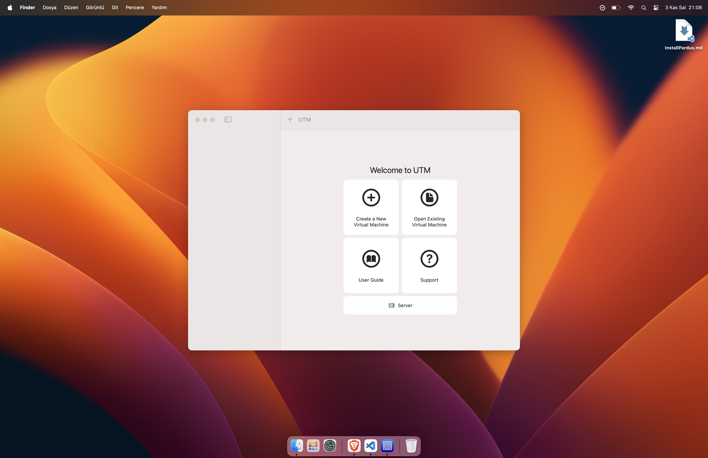

### Adım 2 – Emulate seçimi

**Virtualize** yalnızca Mac'in kendi işlemci mimarisini (ARM) çalıştırabilir. Pardus amd64 olduğu için **Emulate** seçiyoruz.

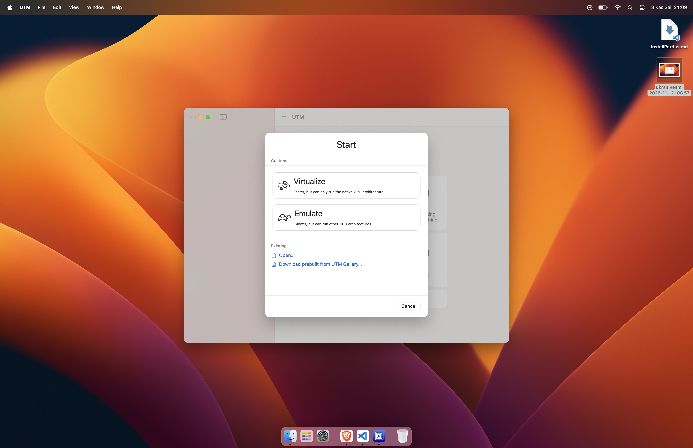

### Adım 3 – İşletim sistemi seçimi

**Linux** seçeneğine tıklıyoruz.

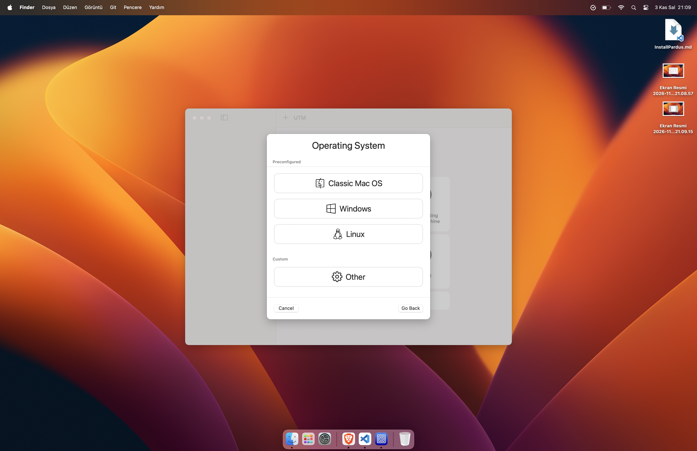

### Adım 4 – Donanım ayarları

- Machine: **Intel ICH9 based PC (2009, x86_64)**
- Memory: **4096 MiB**
- CPU Cores: varsayılan bırakılabilir (daha hızlı kurulum için 4 yapılabilir)

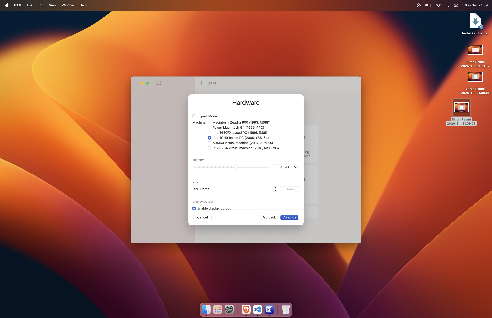

### Adım 5 – ISO dosyasını seçme

**Boot from ISO image** seçili kalıyor. **Browse...** ile indirdiğimiz Pardus ISO dosyasını seçiyoruz.

### Adım 6 – Disk boyutu

Sanal disk boyutunu **30 GiB** olarak belirliyoruz.

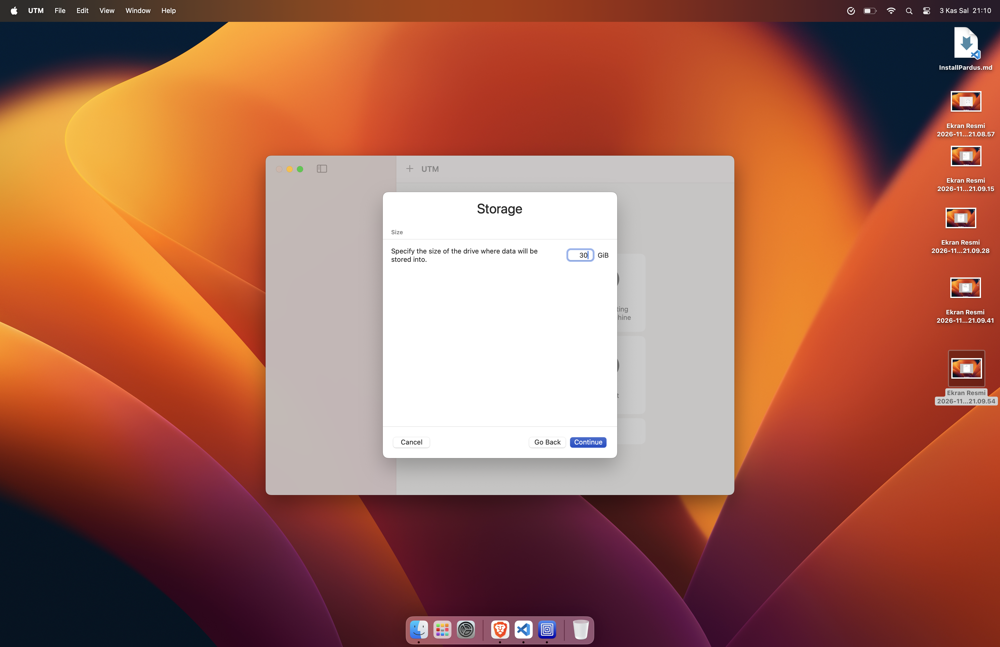

### Adım 7 – Paylaşılan klasör

Bu adım isteğe bağlıdır, boş bırakıp **Continue** diyoruz.

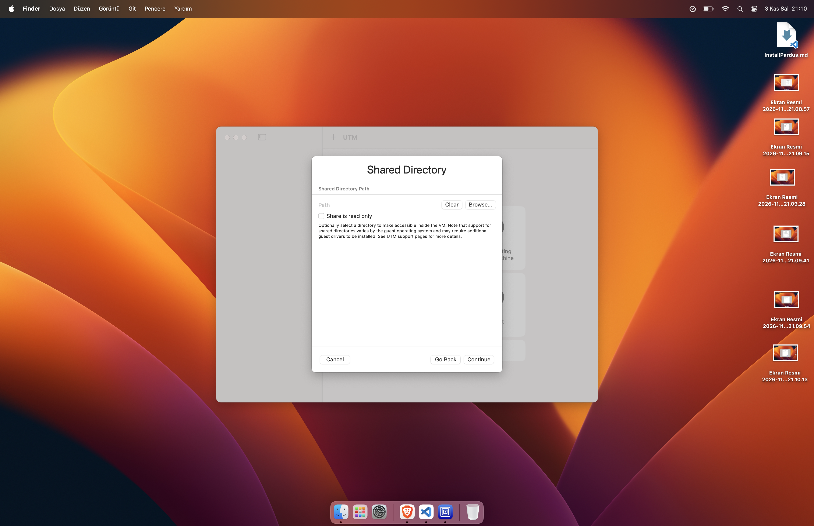

### Adım 8 – Özet

Ayarları kontrol edip **Save** diyoruz. (İsim alanına istenirse "Pardus" yazılabilir.)

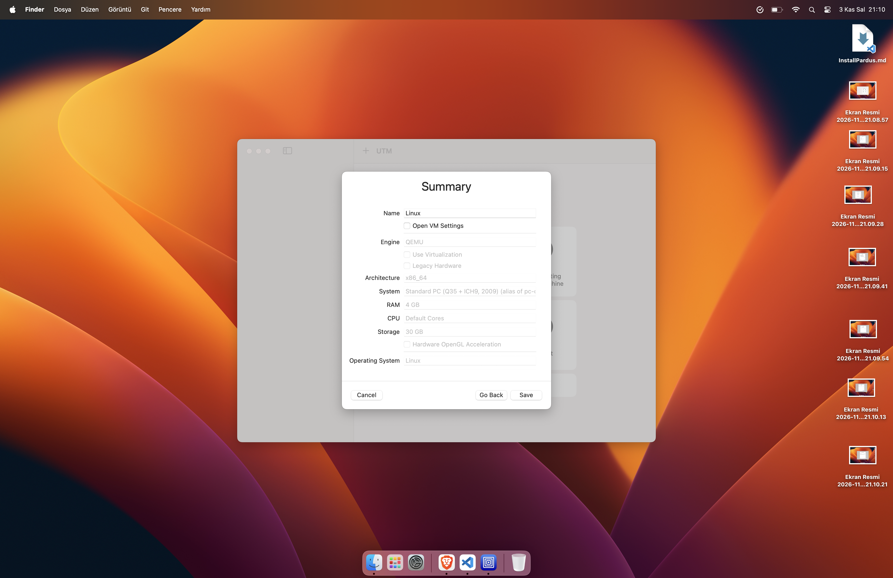

### Adım 9 – Sanal makineyi başlatma

Oluşturulan sanal makineyi seçip ortadaki **▶️** butonuyla başlatıyoruz.

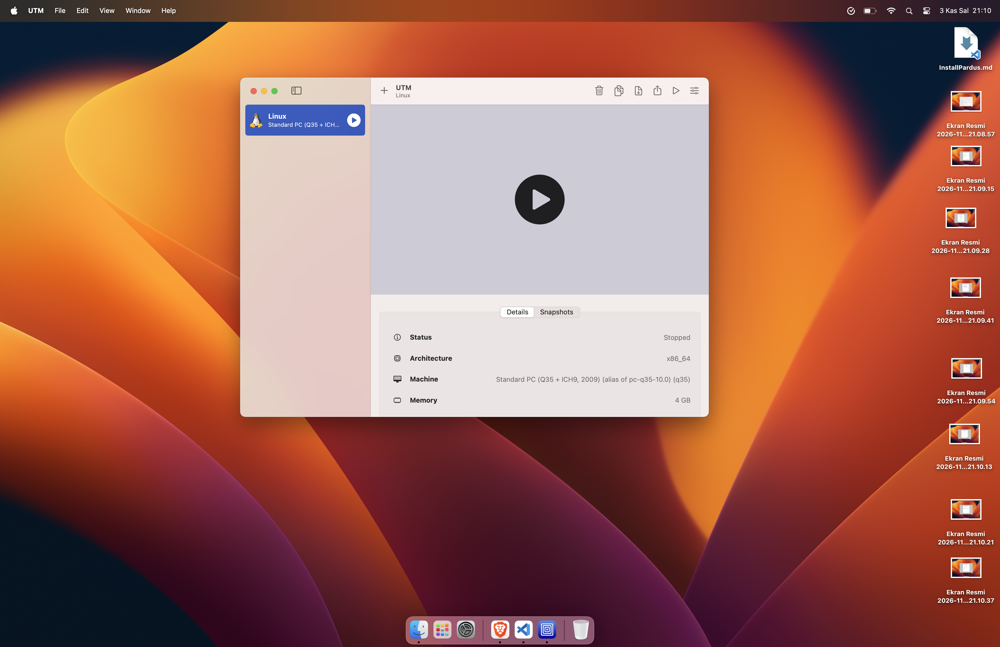

### Adım 10 – Dil seçimi

Pardus kurulumu açılıyor. Dil olarak **Turkish – Türkçe** seçip **Continue** diyoruz.

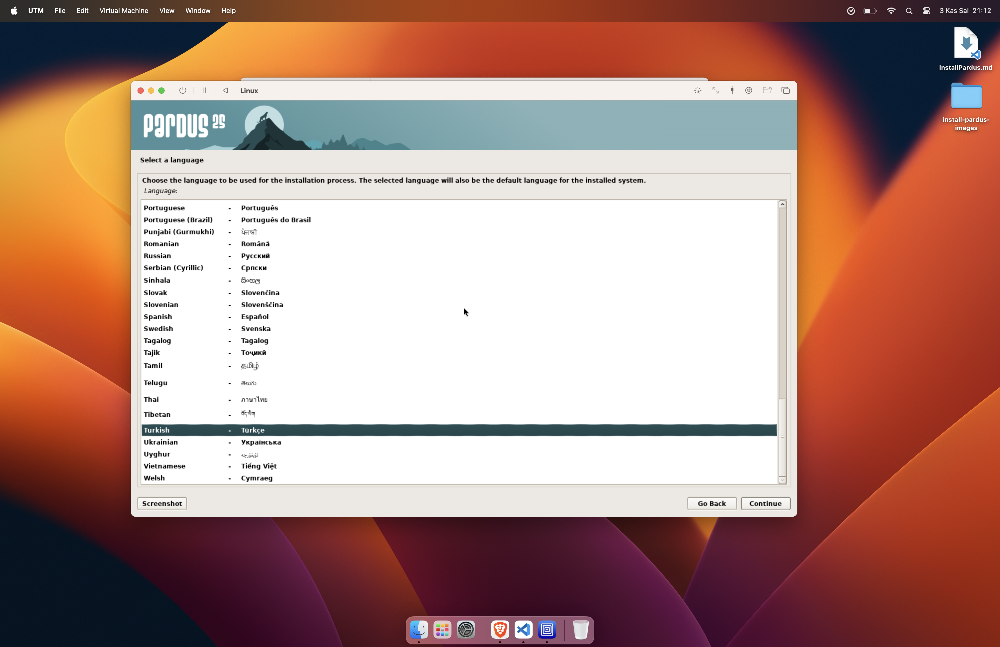

### Adım 11 – Konum seçimi

Ülke olarak **Türkiye** seçip **Devam** diyoruz. Bu seçim saat dilimini de belirler.

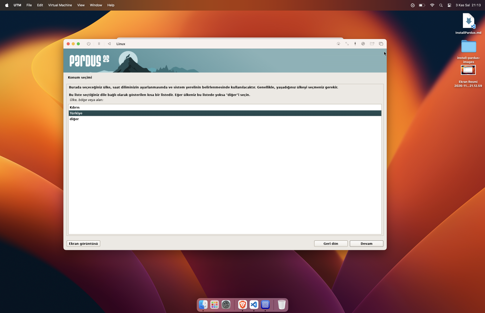

### Adım 12 – Klavye düzeni

Klavye düzeni olarak **Türkçe (Q düzeni)** seçip **Devam** diyoruz.

### Adım 13 – Bölümleme yöntemi

Bölümleme yöntemi olarak **Yardımcı ile – diskin tamamını kullan** seçeneğini seçiyoruz.
Bu işlem yalnızca UTM'de oluşturduğumuz sanal diski etkiler, Mac'teki verilere dokunmaz.

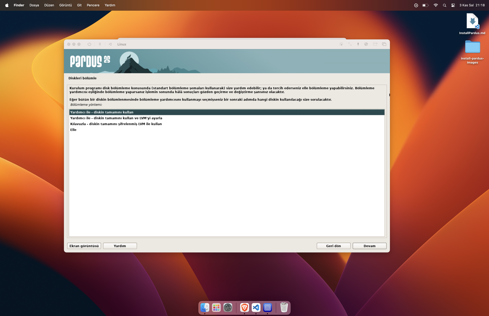

### Adım 14 – Disk seçimi

Listede yalnızca UTM'nin oluşturduğu sanal disk bulunur: **SCSI2 (0,0,0) (sda) – 32.2 GB ATA QEMU HARDDISK**.
Bu diski seçip **Devam** diyoruz.

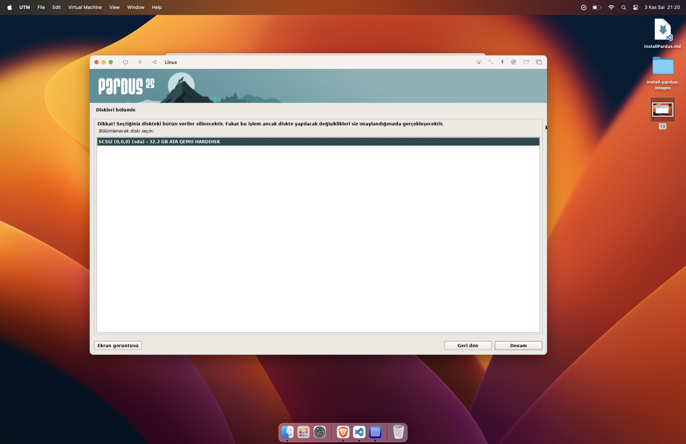

### Adım 15 – Bölümleme şeması

**Tüm dosyalar tek bölümde (yeni kullanıcılara önerilir)** seçeneğini seçiyoruz.

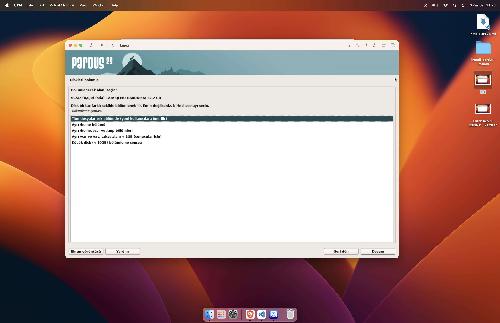

### Adım 16 – Bölümleme özeti

Kurulum yardımcısı sanal diski otomatik olarak bölümlere ayırır:

- **ESP (1 GB):** Açılış (boot) dosyaları
- **ext4 – / (29.5 GB):** Pardus'un kurulduğu ana bölüm
- **takas (1.7 GB):** Takas alanı (swap)

**Bölümlemeyi bitir ve değişiklikleri diske kaydet** seçip **Devam** diyoruz.

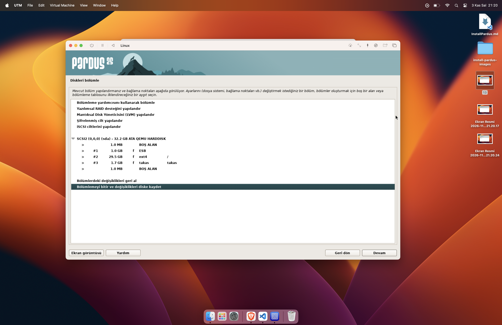

### Adım 17 – Değişiklikleri onaylama

"Değişiklikler diske kaydedilsin mi?" sorusunda varsayılan olarak **Hayır** seçilidir.
Kurulumun devam etmesi için **Evet**'i seçip **Devam** diyoruz.

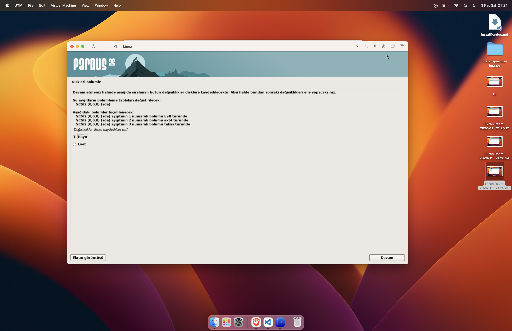
