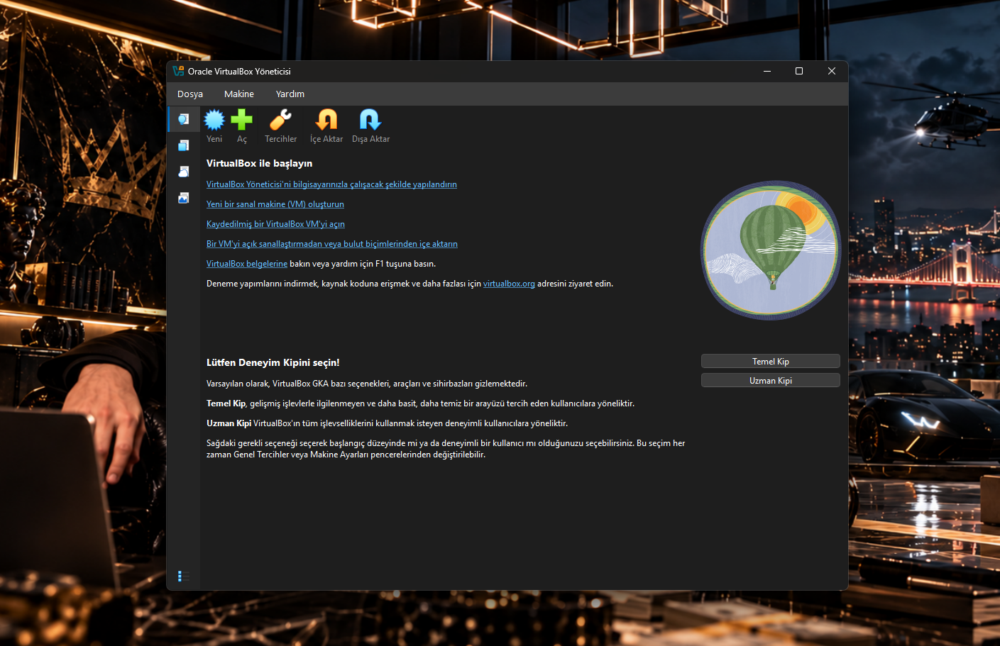
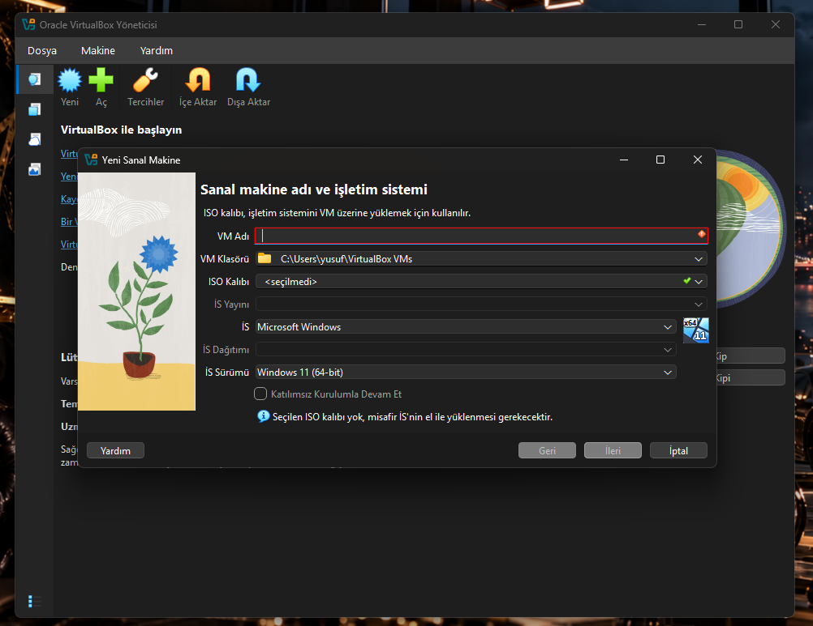
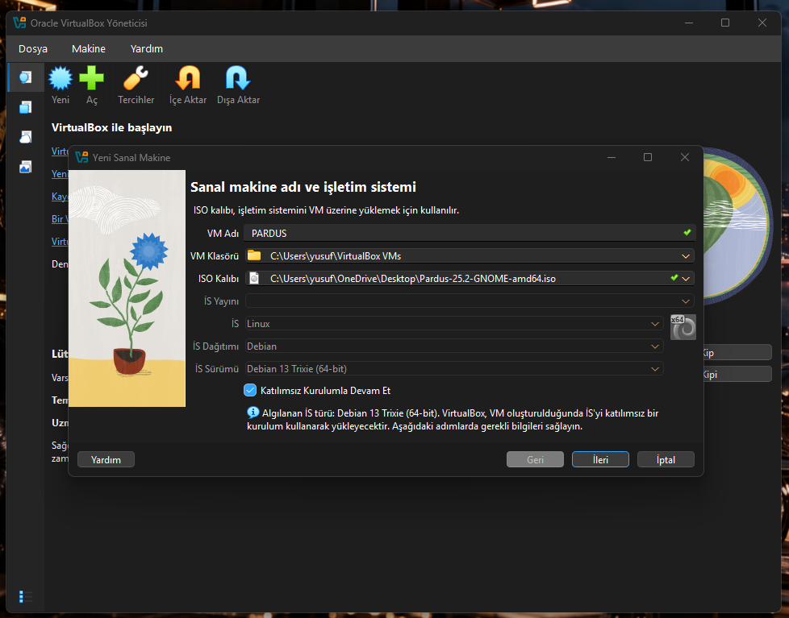
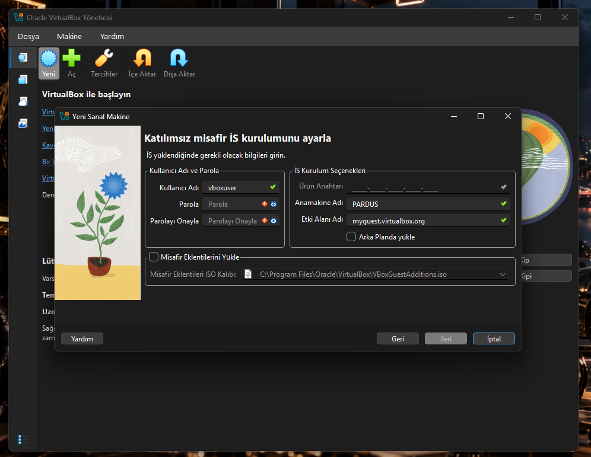
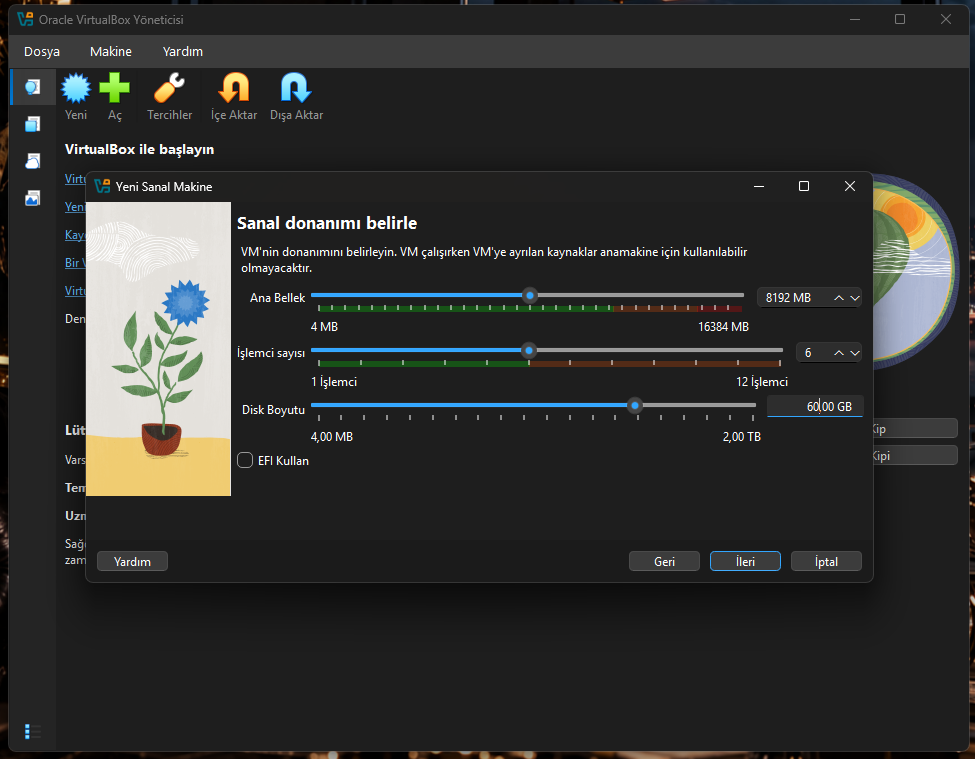
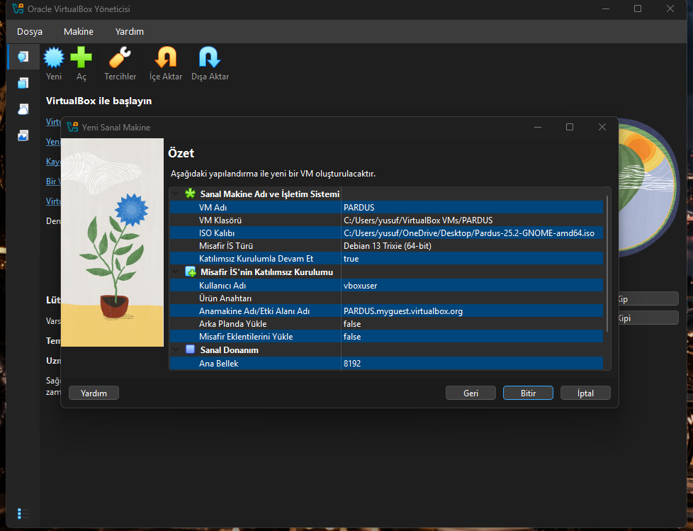
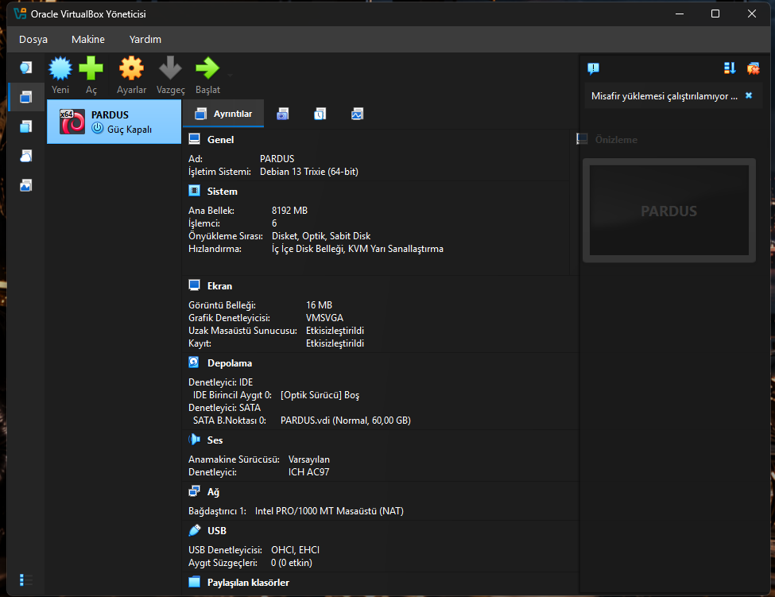
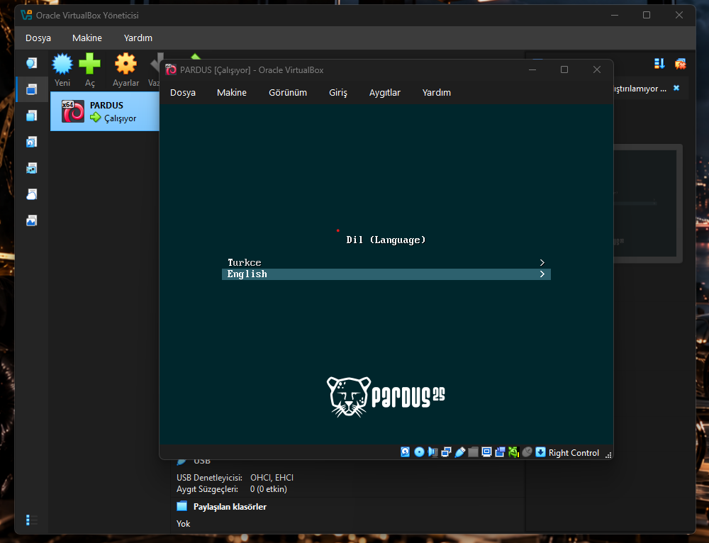
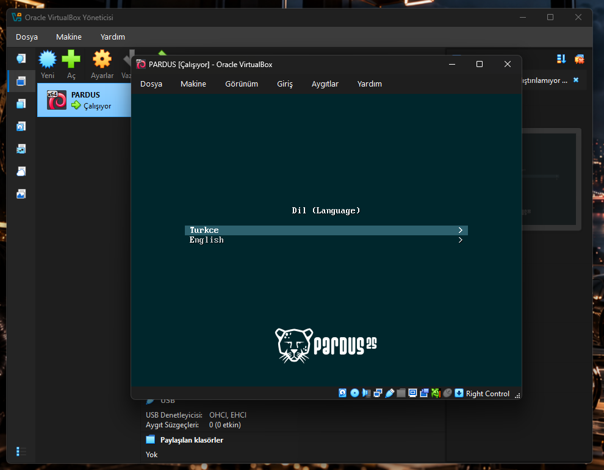
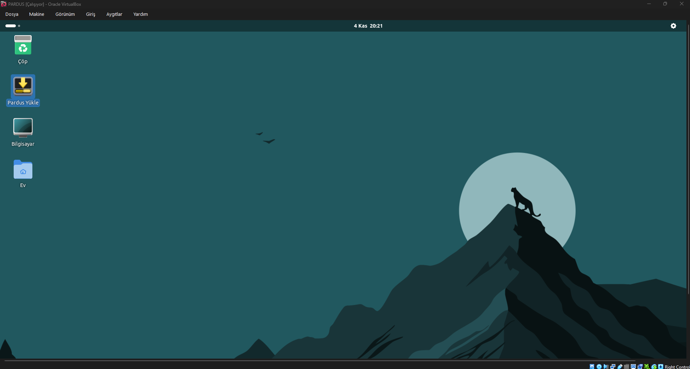

# 1. Download VirtualBox

- [VirtualBox indirme sayfasından](https://www.virtualbox.org/wiki/Downloads) **Windows hosts** sürümünü indiriyoruz.
- İnen `.exe` dosyasını çalıştırıp kurulumu varsayılan ayarlarla tamamlıyoruz.

# 2. Download Pardus ISO

- [Pardus indirme sayfasından](https://pardus.org.tr/en/download) en güncel sürümü indiriyoruz.
- Kullanılan dosya: `Pardus-25.2-GNOME-amd64.iso`

# 3. Step by Step Create Pardus in VirtualBox

### Adım 1 – VirtualBox'ı açma

VirtualBox açıldığında deneyim kipi olarak **Temel Kip** seçilebilir. Ardından üst menüden **Yeni** butonuna tıklıyoruz.

### Adım 2 – Yeni sanal makine penceresi

Sanal makine adı ve işletim sistemi bilgilerini gireceğimiz pencere açılır.

### Adım 3 – İsim ve ISO seçimi

- **VM Adı:** PARDUS
- **ISO Kalıbı:** indirdiğimiz `Pardus-25.2-GNOME-amd64.iso` dosyası
- VirtualBox ISO'yu **Debian 13 Trixie (64-bit)** olarak tanır. Pardus Debian tabanlı olduğu için bu doğrudur.
- **Katılımsız Kurulumla Devam Et** kutusunun **işaretini kaldırmanızı** öneririz. VirtualBox Pardus'u Debian sandığı için otomatik kurulumu tamamlayamaz; kurulumu elle yapmak daha sağlıklıdır.

### Adım 4 – Katılımsız kurulum ayarları

Katılımsız kurulum seçili bırakılırsa bu ekran gelir (kullanıcı adı, parola, anamakine adı).
Önceki adımda kutunun işareti kaldırıldıysa bu ekran görünmez.

### Adım 5 – Sanal donanım

- **Ana Bellek:** 8192 MB
- **İşlemci sayısı:** 6
- **Disk Boyutu:** 60 GB
- **EFI Kullan:** işaretsiz

### Adım 6 – Özet

Ayarları kontrol edip **Bitir** diyoruz.

### Adım 7 – Sanal makineyi başlatma

Sanal makine listede **Güç Kapalı** olarak görünür. Seçip üstteki **Başlat** butonuna tıklıyoruz.

### Adım 8 – Dil seçimi

Pardus açılış ekranında dil seçeneği gelir.

### Adım 9 – Türkçe seçimi

Klavyedeki ok tuşlarıyla **Turkce**'yi seçip **Enter**'a basıyoruz.

### Adım 10 – Canlı (live) masaüstü

Pardus canlı oturumda açılır. Bu aşamada sistem henüz diske kurulmamıştır, ISO üzerinden çalışmaktadır.
Kurulumu başlatmak için masaüstündeki **Pardus Yükle** simgesine çift tıklıyoruz.

